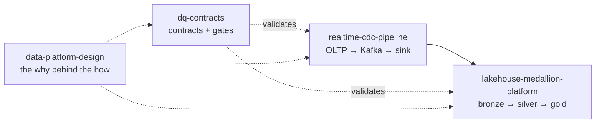

## Hi, I'm Subramani 👋

**Lead Data Engineer** in Hyderabad, India, with 9+ years building data platforms at **Atlassian**,
**PayPal** and **Deloitte**. I lead a small data engineering team and stay hands-on: lakehouse
architecture on Databricks, batch and streaming pipelines, and the reliability work that keeps them
correct (data contracts, observability, idempotent backfills).

- 🏗️ Lakehouse platforms: Databricks (Unity Catalog, Delta Live Tables, Delta Lake), Spark, Iceberg
- 🌊 Streaming & CDC: Kafka, Debezium, Spark Structured Streaming, Flink
- ✅ Data reliability: contracts, quality gates, SLAs/SLOs, lineage, incident response
- 👥 Leading engineers: design reviews, mentoring, hiring, DataOps practices

### Featured projects

| Project | What it shows |
|---|---|
| [**lakehouse-medallion-platform**](https://github.com/CodeWithSubramani/lakehouse-medallion-platform) | Spark + Delta medallion lakehouse: idempotent bronze (Delta txn versions), MERGE-if-newer and SCD2 silver with quarantine, point-in-time gold with partition-scoped rebuilds. End-to-end tests reconcile gold to silver to the cent. |
| [**realtime-cdc-pipeline**](https://github.com/CodeWithSubramani/realtime-cdc-pipeline) | Postgres → Debezium → Kafka → warehouse with LSN-guarded upserts. Tests prove every event permutation converges; DLQ, retry-without-commit, event-time windows with watermarks. |
| [**dq-contracts**](https://github.com/CodeWithSubramani/dq-contracts) | Data contracts library: SQL-pushdown validation, robust (median/MAD) volume anomaly detection, and a semver gate that blocks breaking schema changes in producer CI. |
| [**data-platform-design**](https://github.com/CodeWithSubramani/data-platform-design) | System designs and ADRs: ad-click aggregation at 1M events/s, multi-tenant platform, batch→CDC migration, lakehouse cost, data SLAs. |

### How these fit together

### Toolbox

`Python` `SQL` `PySpark` `Scala` · `Databricks` `Delta Lake` `Iceberg` `Spark` `Flink` `Trino` ·
`Kafka` `Debezium` · `Airflow` `Databricks Workflows` · `AWS (S3, EMR, Glue, Kinesis)` `GCP (BigQuery, Pub/Sub, Dataflow)` ·
`CI/CD` `Docker` `IaC`

### Connect

[LinkedIn](https://www.linkedin.com/in/sr-data-works)
